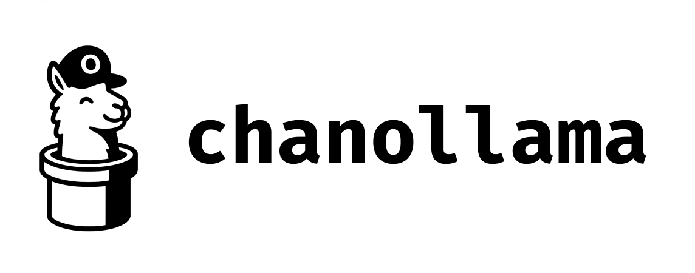

**Truly offline LLM inference with Go channels and goroutines**

`chanollama` is based on the work of Ollama, but with the focus on running LLMs without HTTP communication. It uses Go channels and goroutines to provide real-time token streaming through direct model execution, enabling true offline AI applications that can be distributed with embedded models.

## 🎯 Core Vision

**True Offline Operation**: The purpose of chanollama is to eliminate all network dependencies, including localhost HTTP calls. Instead of communicating with Ollama server, chanollama loads and runs LLM models directly in-process, using Go's concurrency primitives (channels and goroutines) to facilitate streaming responses.

This architecture enables:
- **Embedded Distribution**: Ship applications with models included
- **Zero Network Dependency**: No Ollama server, no HTTP calls, no localhost communication  
- **Pure Go Streaming**: Real-time token generation using channels and goroutines
- **Portable Deployment**: Run anywhere without external dependencies

## ✨ Features

- **🚀 Simple Setup** - Direct model loading: `chanollama.New("/path/to/model.gguf")`
- **📡 Real-time Streaming** - Channel-based, non-blocking token delivery via goroutines
- **🧠 Context Management** - Built-in conversation history and trimming
- **🔧 System Prompts** - Easy specialization of AI behavior
- **📚 RAG Support** - Vector and keyword-based document retrieval
- **🔍 Smart Stopwords** - Embedded 1,298 stopwords with flexible configuration
- **🤖 Agent Framework** - Multi-agent systems with intelligent routing
- **⚡ Performance** - Concurrent conversations, efficient token handling
- **🛡️ Production Ready** - Error handling, timeouts, goroutine safety
- **🔌 True Offline** - Direct model execution without external dependencies

✅ **Fully Offline**: No external dependencies or servers required - models run directly in-process.

## 📦 Installation

```bash
go get github.com/jrschumacher/chanollama
```

## 🚀 Quick Start

```go
package main

import (
    "fmt"
    "log"
    "github.com/jrschumacher/chanollama"
)

func main() {
    // Create offline client with direct model file
    config := &chanollama.Config{
        ModelPath:   "/path/to/model.gguf",
        OfflineMode: true,
        Temperature: 0.7,
    }
    
    client, err := chanollama.NewOfflineClient(config)
    if err != nil {
        log.Fatalf("Failed to create offline client: %v", err)
    }
    defer client.Close()

    // Simple chat
    messages := []chanollama.Message{
        {Role: "user", Content: "Hello!"},
    }

    response, err := client.Chat(messages)
    if err != nil {
        panic(err)
    }
    
    fmt.Println("Response:", response.Content)
    
    // Real-time streaming
    client.ChatStream(messages, func(token string) {
        fmt.Print(token) // Tokens appear in real-time
    })
}
```

## 📖 Examples

### 🔄 Channel-Based Streaming

```go
engine, err := chanollama.NewOfflineEngine("/path/to/model.gguf")
if err != nil {
    log.Fatalf("Failed to create offline engine: %v", err)
}
defer engine.Close()

// Get channels for tokens and errors
tokenCh, errorCh := engine.ChatStreamChan(messages)

for {
    select {
    case token, ok := <-tokenCh:
        if !ok {
            return // Streaming complete
        }
        fmt.Print(token)
        
    case err := <-errorCh:
        if err != nil {
            log.Printf("Error: %v", err)
            return
        }
    }
}
```

### 🧠 Context-Aware Conversations

```go
// Create offline client
client, err := chanollama.NewOfflineClient(&chanollama.Config{
    ModelPath: "/path/to/model.gguf",
    OfflineMode: true,
})
if err != nil {
    log.Fatal(err)
}
defer client.Close()

// Automatic conversation management
conversation := chanollama.NewConversation()
conversation.AddSystemMessage("You are a helpful coding assistant.")

// Messages are automatically managed and trimmed
conversation.AddUserMessage("What is Go?")
response, _ := client.Chat(conversation.Messages)
conversation.AddAssistantMessage(response.Content)

conversation.AddUserMessage("Show me an example")
response, _ = client.Chat(conversation.Messages) // Includes full context
```

### 🔧 System Prompts

```go
messages := []chanollama.Message{
    {
        Role: "system", 
        Content: "You are a helpful coding assistant specialized in Go programming.",
    },
    {Role: "user", Content: "How do I handle errors in Go?"},
}

response, _ := client.Chat(messages)
```

### ⚡ Concurrent Streaming

```go
// Handle multiple conversations simultaneously
streamer, err := chanollama.NewOfflineConcurrentStreamer("/path/to/model.gguf", 5) // Max 5 concurrent
if err != nil {
    log.Fatal(err)
}
defer streamer.Close()

var wg sync.WaitGroup
for _, question := range questions {
    wg.Add(1)
    go func(q string) {
        defer wg.Done()
        
        messages := []chanollama.Message{{Role: "user", Content: q}}
        tokenCh, errorCh := streamer.Stream(messages)
        
        // Process streaming response...
    }(question)
}
wg.Wait()
```

### 📦 Token Batching

```go
// Create offline engine
engine, err := chanollama.NewOfflineEngine("/path/to/model.gguf")
if err != nil {
    log.Fatal(err)
}
defer engine.Close()

// Batch tokens for efficient processing
batcher := chanollama.NewTokenBatcher(5, 50*time.Millisecond)
tokenCh, _ := engine.ChatStreamChan(messages)
batchCh := batcher.BatchTokens(tokenCh)

for batch := range batchCh {
    // Process 5 tokens at a time or every 50ms
    for _, token := range batch {
        fmt.Print(token)
    }
}
```

## 🔧 Configuration

```go
config := chanollama.Config{
    ModelPath:   "/path/to/model.gguf",
    OfflineMode: true,
    Timeout:     30 * time.Second,
    MaxTokens:   2048,
    Temperature: 0.7,
    UseGPU:      false,
    NumThreads:  4,
    ContextSize: 4096,
}

client, err := chanollama.NewOfflineClient(&config)
if err != nil {
    log.Fatal(err)
}
defer client.Close()
```

## 📋 Requirements

- **Go 1.24+**
- **GGUF/GGML model file** (e.g., downloaded from Hugging Face)
- **Sufficient RAM** for model inference (varies by model size)
- **No external dependencies** - models load directly from GGUF files

## 🎯 Use Cases

### 🤖 Chatbots
```go
// Create offline client
client, err := chanollama.NewOfflineClient(&chanollama.Config{
    ModelPath: "/path/to/model.gguf",
    OfflineMode: true,
})
if err != nil {
    log.Fatal(err)
}
defer client.Close()

conversation := chanollama.NewConversation()
conversation.AddSystemMessage("You are a friendly customer service bot.")

for userInput := range userInputChannel {
    conversation.AddUserMessage(userInput)
    response, _ := client.Chat(conversation.Messages)
    conversation.AddAssistantMessage(response.Content)
    
    // Send response back to user
    sendToUser(response.Content)
}
```

### 🔍 AI-Powered Search
```go
client, err := chanollama.NewOfflineClient(&chanollama.Config{
    ModelPath: "/path/to/model.gguf",
    OfflineMode: true,
})
if err != nil {
    log.Fatal(err)
}
defer client.Close()

messages := []chanollama.Message{
    {Role: "system", Content: "You are a search assistant. Provide concise, relevant answers."},
    {Role: "user", Content: searchQuery},
}

client.ChatStream(messages, func(token string) {
    // Stream results in real-time
    updateSearchResults(token)
})
```

### 💻 Code Assistant
```go
client, err := chanollama.NewOfflineClient(&chanollama.Config{
    ModelPath: "/path/to/model.gguf",
    OfflineMode: true,
})
if err != nil {
    log.Fatal(err)
}
defer client.Close()

codeAssistant := []chanollama.Message{
    {Role: "system", Content: "You are an expert programmer. Provide clean, well-documented code."},
    {Role: "user", Content: "Write a REST API handler in Go"},
}

response, _ := client.Chat(codeAssistant)
```

### 📚 RAG (Retrieval-Augmented Generation)
```go
// Create document store
vectorStore := chanollama.NewVectorStore("./vector_index.json")

// Add documents
docs := []chanollama.Document{
    {ID: "1", Title: "Go Guide", Content: "Go is a programming language..."},
    {ID: "2", Title: "HTTP APIs", Content: "Building REST APIs in Go..."},
}
vectorStore.AddDocuments(docs)

// Simple keyword-based RAG
simpleRAG := chanollama.NewSimpleRAGStore("./simple_index.json")
simpleRAG.AddDocument(chanollama.Document{
    ID: "doc1", Content: "OpenTDF provides data security...",
})

// Query with RAG context
query := "How do I build secure APIs?"
ragContext := simpleRAG.BuildRAGContext(query, 3)
messages := []chanollama.Message{
    {Role: "system", Content: "Use this context: " + ragContext},
    {Role: "user", Content: query},
}
```

### 🔍 Flexible Stopwords Configuration
```go
// Use default embedded stopwords (1,298 words)
keywords := chanollama.ExtractKeywords(text)

// Add domain-specific stopwords
config := chanollama.StopwordsConfig{
    UseDefault: true,
    Additional: []string{"api", "endpoint", "service"},
}
keywords := chanollama.ExtractKeywordsWithConfig(text, config)

// Use completely custom stopwords
config := chanollama.StopwordsConfig{
    Override: []string{"the", "a", "an"},
}
keywords := chanollama.ExtractKeywordsWithConfig(text, config)
```

## 📚 Documentation

For comprehensive documentation, see the [docs directory](./docs/):

- **[Getting Started](./docs/getting-started.md)** - Installation and quick start guide
- **[RAG Documentation](./docs/rag.md)** - Complete guide to document retrieval and search
- **[Agents Framework](./docs/agents.md)** - Multi-agent systems and intelligent routing
- **[Configuration](./docs/configuration.md)** - Configuration options and environment setup

For API reference, use Go's built-in documentation:
```bash
go doc github.com/jrschumacher/chanollama
godoc -http=:6060  # Local documentation server
```

### 🔍 Quick API Reference

#### Core Types

```go
type Message struct {
    Role    string // "system", "user", "assistant"
    Content string
}

type Response struct {
    Content string
    Error   error
    Tokens  int
}

type StreamCallback func(token string)
```

### Client Methods

```go
// Offline client
config := &chanollama.Config{
    ModelPath: "/path/to/model.gguf",
    OfflineMode: true,
}
client, err := chanollama.NewOfflineClient(config)
response, err := client.Chat(messages)
response := client.ChatStream(messages, callback)
healthy := client.IsHealthy()
client.Close()

// Offline streaming engine
engine, err := chanollama.NewOfflineEngine("/path/to/model.gguf")
tokenCh, errorCh := engine.ChatStreamChan(messages)
tokenCh, errorCh := engine.ChatStreamChanWithTimeout(messages, timeout)
```

### Conversation Management

```go
conv := chanollama.NewConversation()
conv.AddUserMessage("content")
conv.AddAssistantMessage("content")
conv.AddSystemMessage("content")
tokens := conv.EstimateTokens()
```

## 🛡️ Error Recovery & Safety

chanollama includes built-in error recovery and panic handling to ensure robust operation:

### Error Types

```go
import "github.com/jrschumacher/chanollama"

// Predefined error types for better error handling
var (
    ErrBatchSizeExceeded = errors.New("conversation too long for model batch size")
    ErrTokenCountFailed  = errors.New("unable to count tokens, using message limit fallback")
    ErrModelNotLoaded    = errors.New("model not loaded or initialization failed")
    ErrInferenceFailed   = errors.New("inference operation failed")
    ErrContextOverflow   = errors.New("context size exceeded, conversation truncated")
)
```

### Automatic Conversation Management

The library automatically prevents batch size crashes by truncating conversations:

```go
// Client automatically manages conversation length
client := chanollama.New("/path/to/model.gguf")

// Configure conversation limits
client.SetConversationConfig(chanollama.ConversationConfig{
    MaxTokens:      3200,  // 80% of batch size
    MaxMessages:    50,    // Fallback limit
    KeepSystemMsg:  true,  // Preserve system messages
    TruncateOldest: true,  // Remove oldest messages first
})

// Long conversations are automatically truncated
messages := []chanollama.Message{
    // ... many messages that would exceed batch size ...
}

response, err := client.Chat(messages) // Automatically truncated
if response.Metadata["truncated_messages"] != "" {
    log.Printf("Truncated %s messages", response.Metadata["truncated_messages"])
}
```

### Panic Recovery

All inference operations are wrapped with panic recovery:

```go
// The library includes built-in panic recovery
// Panics are logged and converted to errors
response, err := client.Chat(messages)
if err != nil {
    // Handle graceful error instead of crash
    if errors.Is(err, chanollama.ErrInferenceFailed) {
        log.Printf("Inference failed: %v", err)
    }
}
```

### Safety Wrapper for Implementers

For applications using chanollama (like otdfctl), add this safety wrapper:

```go
// In your application code
func safeEngineCall(fn func() (*chanollama.Response, error)) (*chanollama.Response, error) {
    defer func() {
        if r := recover(); r != nil {
            log.Printf("Engine call panic: %v", r)
        }
    }()
    return fn()
}

// Usage in your CLI or application
response, err := safeEngineCall(func() (*chanollama.Response, error) {
    return client.Chat(messages)
})
```

### Conversation Truncation Info

Get detailed information about conversation truncation:

```go
manager := client.GetConversationManager()
info := manager.GetTruncationInfo(messages)

fmt.Printf("Original: %d messages, %d tokens\n", info.OriginalCount, info.OriginalTokens)
fmt.Printf("Truncated: %d messages, %d tokens\n", info.TruncatedCount, info.TruncatedTokens)
fmt.Printf("Will truncate: %v\n", info.WillTruncate)
```

## 🛠️ Advanced Features

### Custom Timeout
```go
tokenCh, errorCh := engine.ChatStreamChanWithTimeout(messages, 10*time.Second)
```

### Stream Collection
```go
collector := chanollama.NewStreamCollector()
response, err := collector.Collect(tokenCh, errorCh)
```

### Concurrent Control
```go
streamer, err := chanollama.NewOfflineConcurrentStreamer("/path/to/model.gguf", maxConnections)
```

## 🤝 Contributing

1. Fork the repository
2. Create a feature branch
3. Make your changes
4. Add tests
5. Submit a pull request

## 📄 License

MIT License - see [LICENSE](LICENSE) file for details.

## 🙏 Acknowledgments

- [llama.cpp](https://github.com/ggerganov/llama.cpp) for the excellent offline inference engine
- The Go community for inspiration on clean API design

---

**Made with ❤️ for the Go and AI community**